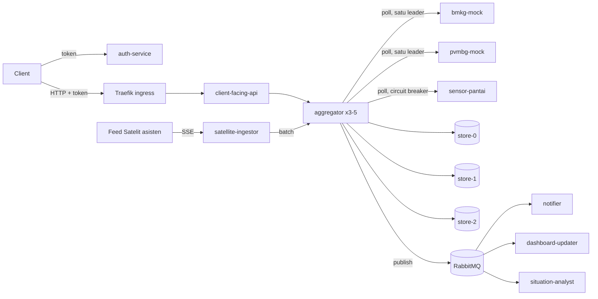

# Sistem Informasi Kebencanaan BNPB (IF4031 Milestone 2)

Platform agregasi informasi kebencanaan yang berjalan di cluster Kubernetes (k3s) dua node. Sistem mengambil data gempa
(BMKG), gunung api (PVMBG), titik panas satelit (Feed Satelit asisten), dan sensor pantai (image Sensor Pantai asisten),
memetakannya ke satu format `HazardEvent`, menyimpannya tersebar dengan replikasi di tiga unit MongoDB, lalu menyebarkannya
lewat RabbitMQ ke consumer dan lewat API ke client dengan hak akses berbeda per jenis client.

| Repositori | Isi |
|---|---|
| ini (`IF4031_chisli1`) | Kode semua service (`services/`), Docker Compose untuk pengembangan lokal, pengujian P1-P5 (`tests/`), bukti (`docs/bukti/`), dokumentasi (`docs/`) |
| `IF4031_chisli1_infra` | Chart Helm, values per environment, Argo CD, policy Kyverno, skrip cluster dan platform, observabilitas. Lihat README di sana |

Dokumen pendukung: [docs/topologi-arsitektur.md](docs/topologi-arsitektur.md) (topologi dan penempatan pod),
[docs/bukti/](docs/bukti/) (bukti per problem), [docs/bukti/observabilitas/](docs/bukti/observabilitas/).

## Arsitektur



| Komponen | Peran |
|---|---|
| `aggregator` | 3-5 instance. Satu leader (Lease dengan fencing token) yang mengambil BMKG dan PVMBG; penyimpanan tersebar (consistent hashing, replikasi faktor 2 di 3 unit); DLQ pesan yang gagal; Audit API; dashboard analitik `/dashboard` |
| `client-facing-api` | API client (`/hazard-events`, `POST /field-reports`), kelas prioritas untuk Tim Lapangan, penolakan 429 terkontrol untuk Media |
| `auth-service` | Token client (Media, Tim Lapangan, Internal Ops) dengan hak akses berbeda |
| `satellite-ingestor` | Membaca aliran SSE Feed Satelit, membentuk kebakaran sesuai Definisi Kebakaran, checkpoint di aggregator |
| `notifier`, `dashboard-updater`, `situation-analyst` | Consumer RabbitMQ: peringatan Tim Lapangan, keadaan dashboard, ringkasan situasi (komponen AI, bonus) |
| `store-0..2` | MongoDB, satu unit per pod, data di disk node (`local-path`) |
| `bmkg-mock`, `pvmbg-mock` | Mock sumber data dengan endpoint admin (`/admin/outage`, `/admin/schema-version`) |
| `sensor-pantai` | Image asisten, tidak dimodifikasi |

## Deklarasi topologi

| Node | Jenis | Host fisik | Spesifikasi host | Sumber daya node | Arsitektur |
|---|---|---|---|---|---|
| `chisli-control` (control plane + worker) | VM WSL2 (Ubuntu 26.04) | Laptop Windows | Intel Core i7-12650H, RAM 16 GB | 8 vCPU / 10 GB (batas WSL2) | amd64 |
| `chisli-worker-1` (worker) | VM Colima (Ubuntu 24.04) | MacBook Air M1 (2020) | Apple M1, RAM 8 GB, SSD 512 GB | 3 vCPU / 4,8 GiB (VM Colima) | arm64 |

Kedua node terhubung lewat Tailscale (100.66.57.46 dan 100.109.151.22). Rincian penempatan pod, resource per layanan, dan keterbatasan topologi ada di
[docs/topologi-arsitektur.md](docs/topologi-arsitektur.md).

## Deploy ke cluster

Deploy dikelola dari repositori infra (GitOps dengan Argo CD). Ringkasnya, dengan cluster k3s dua node yang sudah `Ready`
(panduan pembuatan cluster: `docs/k3s-cluster.md` di repo infra):

**Satu perintah deploy:** jalankan workflow CI repo infra di self-hosted runner (push ke `main` repo infra juga memicunya):

```
gh workflow run ci.yml --ref main --repo <owner>/IF4031_chisli1_infra
```

Workflow menjalankan validasi, pemasangan platform (Traefik, metrics-server, Kyverno, KEDA, Argo CD), policy, Secret, dan
`ApplicationSet` (Argo CD lalu men-deploy semua service ke namespace `sistem-informasi-kebencanaan-bnpb`), kemudian memasang
Tester Agent dan observabilitas. Langkah manual yang setara, dan isi file Secret di runner, ada di README repo infra. Setiap push ke
`main` repo ini membangun image baru dan menulis tag ke repo infra; Argo CD menerapkannya otomatis.

Akses (Traefik pada `127.0.0.1:80` di node control):

| Alamat | Isi |
|---|---|
| `http://api.prod.localtest.me` | API client (`/hazard-events`, `/field-reports`) |
| `http://auth.prod.localtest.me` | Token (`POST /token`) |
| `http://ops.prod.localtest.me/dashboard` | Dashboard analitik (P1), termasuk kartu lag pemrosesan satelit (P4) |
| `http://grafana.localtest.me` | Grafana: metrik, trace, log (pengguna `admin`, kata sandi di Secret `observability/grafana-admin`) |

Dari peramban Windows (node control berupa WSL2), hostPort Traefik tidak diteruskan ke Windows; jalankan
`kubectl -n traefik port-forward svc/traefik 8088:80` lalu buka alamat di atas dengan port `:8088`.

## Konfigurasi

Kredensial disimpan sebagai Secret `app-secrets` (daftar kunci: `scripts/secret-keys.txt` di repo infra), konfigurasi sebagai
ConfigMap dari `envs/prod/<service>.yaml` di repo infra. Variabel yang khusus M2:

| Variabel | Nilai prod | Fungsi |
|---|---|---|
| `STORE_UNIT_NAMES`, `STORE_REPLICATION_FACTOR` | `store-0,store-1,store-2`, `2` | Unit penyimpanan dan faktor replikasi (P1) |
| `STORE_UNIT_TIMEOUT_MS` | 5000 | Batas tunggu per unit; unit yang melewatinya ditandai tidak terjangkau |
| `AGGREGATOR_LEADER_ELECTION_ENABLED`, `AGGREGATOR_LEADER_LEASE_DURATION_SECONDS`, `AGGREGATOR_LEADER_RETRY_PERIOD_SECONDS` | `true`, 15, 5 | Satu pengambil data per sumber, lease dengan fencing (P2) |
| `PVMBG_FIELD_ALIASES`, `PVMBG_FIELD_COERCE` | `level_status:alert_level`, `eruption_count_24h:int` | Aturan penyesuaian skema PVMBG setelah perubahan tidak kompatibel (P3) |
| `DLQ_RETRY_INTERVAL_SECONDS` | 5 | Jeda coba ulang pesan berstatus `retrying` (P3) |
| `FIELD_REPORTS_ENABLED`, `FIELD_REPORT_PUBLISH_TIMEOUT_MS` | `true`, 2000 | Jalur `POST /field-reports` (P3) |
| `SATELLITE_LATENESS_MINUTES` | 360 | Batas keterlambatan deteksi satelit (P4) |
| `SATELLITE_HEARTBEAT_TIMEOUT_SECONDS` | 30 | Batas sunyi aliran sebelum menyambung ulang (P4) |
| `SATELLITE_BATCH_MAX`, `SATELLITE_BATCH_WAIT_MS` | 500, 250 | Ukuran dan jeda batch ke aggregator (P4) |
| `AGGREGATOR_PANTAI_CIRCUIT_FAILURES`, `AGGREGATOR_PANTAI_CIRCUIT_OPEN_SECONDS` | 3, 10 | Circuit breaker Sensor Pantai (P5) |
| `AGGREGATOR_PANTAI_TIMEOUT_MS`, `AGGREGATOR_PANTAI_POLL_INTERVAL_MS` | 1500, 1000 | Batas tunggu dan jeda polling sensor (P5) |
| `CLIENT_API_MAX_INFLIGHT`, `CLIENT_API_PRIORITY_RESERVED` | 25, 10 | Permintaan serentak per pod dan slot khusus Tim Lapangan (P5) |
| `CLIENT_API_PRIORITY_HEDGE_MS` | 700 | Panggilan kedua untuk permintaan prioritas yang lambat (P5) |
| `CLIENT_API_PRIORITY_STALE_AFTER_MS`, `CLIENT_API_PRIORITY_MAX_STALE_MS` | 2000, 30000 | Batas tunggu Tim Lapangan; jawaban terakhir bertanda stale bila sumber lambat (P5) |

Variabel M1 (port, kredensial, timeout BMKG/PVMBG, consumer) tercantum di bagian [Pengembangan lokal](#pengembangan-lokal).

## Menjalankan skenario pengujian

Prasyarat di mesin penguji: `kubectl` dengan kubeconfig cluster, `python3`, `k6` (untuk P2 dan P5), dan file env berisi
token (`~/.xops/prod.env`, bentuknya sama dengan `.env.example`). Muat lingkungannya:

```
set -a; . ~/.xops/prod.env; set +a
export KUBECONFIG=~/.kube/k3s-config AGG_URL=http://localhost:8090 AGG_INTERNAL_KEY="$AGGREGATOR_API_KEY"
kubectl -n sistem-informasi-kebencanaan-bnpb port-forward svc/aggregator 8090:8090 &
kubectl -n sistem-informasi-kebencanaan-bnpb port-forward svc/pvmbg-mock 8091:8082 &   # untuk P3
```

Semua bukti sekaligus, dengan log dan tangkapan layar ke `docs/bukti/<problem>/2node/`:

```
tests/tools/run_evidence.sh p1      # atau p2, p3, p4, p5; tanpa argumen menjalankan semuanya
```

Per skenario:

| Problem | Perintah | Kriteria |
|---|---|---|
| P1 | `python3 tests/p1/p1.py load --synthetic 20000` lalu `report` | 1-2: sebaran data dan beban per node |
| P1 | `python3 tests/p1/p1.py surge --region "Kepulauan Mentawai" --count 3000` | 2: lonjakan satu wilayah |
| P1 | `python3 tests/p1/p1.py paginate` | 3: baca lintas unit dengan pagination |
| P1 | `python3 tests/p1/unit_loss.py --victim store-0 --second store-1` | 4-6: unit hilang dan dipulihkan, tahan kehilangan berikutnya |
| P1 | `python3 tests/p1/node_wipe.py` | 4-5: skenario `wipe-node` Tester Agent |
| P1 | `python3 tests/p1/dashboard_check.py` | 7: angka dashboard sama dengan Audit API |
| P2 | `python3 tests/p2/p2.py once`, `unhealthy`, `failover`, `freeze`, `rolling` | 1, 2, 3, 5, 8 |
| P2 | `tests/p2/skew.sh` | 4: jam node bergeser (skenario `clock-skew`) |
| P2 | `tests/tools/ten_k.sh`, `tests/tools/throughput_3x.sh` | 6-7: 10.000 VU dengan 3 -> 5 -> 2 instance, throughput 3 vs 1 instance |
| P3 | `python3 tests/p3/p3.py access`, `schema`, `corrupt`, `recover`, `retry`, `reports` | 1-6 |
| P4 | `python3 tests/p4/p4.py live --menit 5` | 4, 7: aliran live, p95 dan lag |
| P4 | `python3 tests/p4/p4.py stats` | 2-3: terlambat, ditarik, duplikat |
| P4 | `python3 tests/p4/p4.py crash`, `reconnect` | 5, 8: pemroses mati; koneksi feed diputus |
| P4 | `python3 tests/p4/p4.py reference <file>` | 6: dibandingkan dengan hasil referensi asisten (dataset dibagikan setelah tenggat) |
| P5 | `python3 tests/p5/p5.py critical`, `quarantine` | 1-2 (butuh profil ujian Sensor Pantai) |
| P5 | `python3 tests/p5/p5.py unhealthy`, `priority` | 3-4, 5 |
| P5 | `python3 tests/p5/gameday.py --recovery 240` | 6, 8: game day gabungan dan SLO jalur Tim Lapangan |

Tester Agent: daftar skenario `kubectl exec -n tester-agent daemonset/tester-agent -- /app list`, menjalankan skenario latihan
`kubectl exec -n tester-agent daemonset/tester-agent -- /app run practice <nama>`, log aksinya `kubectl logs -n tester-agent daemonset/tester-agent`.
Skenario ujian dijalankan dengan kunci dari asisten setelah tenggat.

Setiap folder bukti berisi hasil yang lolos; run yang gagal disimpan di subfolder `temuan-*` beserta catatannya, dan
catatan per kriteria ada di `CATATAN*.md`.

## Observabilitas

Prometheus, Grafana, Tempo, Loki, dan Alloy di namespace `observability`. Setiap service mengekspos `/metrics` (port 9102),
mengirim trace OTLP, dan menulis log JSON dengan `correlation_id` dan `trace_id`. Dashboard: **BNPB / Service (RED)**,
**BNPB / Alur data dan jalur peringatan** (termasuk SLO peringatan <= 5 detik), **BNPB / Cluster dan node**. Contoh tangkapan,
termasuk satu trace lintas layanan dan log ber-correlation ID, ada di [docs/bukti/observabilitas/](docs/bukti/observabilitas/).

## Pengembangan lokal

Docker Compose menjalankan subset M1 (BMKG, PVMBG, aggregator dengan satu MongoDB, RabbitMQ, consumer, auth, client API)
untuk pengembangan dan unit test, bukan untuk demo M2.

```
cp .env.example .env          # isi AUTH_SIGNING_SEED dengan: openssl rand -base64 32, lalu ganti nilai rahasia lain
docker compose up -d --build
docker compose ps
docker compose down           # tambahkan -v untuk menghapus data
```

| Variabel | Default | Fungsi |
|---|---|---|
| `BMKG_PORT`, `PVMBG_PORT`, `CLIENT_API_PORT`, `AUTH_PORT`, `AGGREGATOR_PORT` | 8081, 8082, 8080, 8091, 8090 | Port service |
| `BMKG_API_KEY`, `PVMBG_TOKEN` | wajib | Kredensial sumber |
| `BMKG_DELAY_MS`, `PVMBG_DELAY_MIN_MS`, `PVMBG_DELAY_MAX_MS` | 100, 500, 3000 | Delay simulasi sumber |
| `BMKG_SEED_COUNT`, `PVMBG_SEED_COUNT` | 20 | Jumlah data awal |
| `BMKG_GENERATION_INTERVAL_SECONDS`, `PVMBG_GENERATION_INTERVAL_SECONDS` | 10 | Jarak kemunculan data baru |
| `AUTH_SIGNING_SEED`, `AUTH_INTERNAL_KEY` | wajib | Kunci penandatangan token dan kunci `/revocations` |
| `AUTH_ACCESS_TTL_SECONDS`, `AUTH_REFRESH_TTL_SECONDS` | 60, 600 | Umur token |
| `AUTH_CLIENT_{MEDIA,FIELD,OPS}_{ID,SECRET}` | wajib | Identitas client Media, Tim Lapangan, Internal Ops |
| `AGGREGATOR_API_KEY` | wajib | Kunci `X-Internal-Key` ke aggregator |
| `AGGREGATOR_POLL_INTERVAL_SECONDS` | 5 | Interval polling BMKG dan PVMBG |
| `AGGREGATOR_BMKG_TIMEOUT_MS`, `AGGREGATOR_PVMBG_TIMEOUT_MS` | 2000, 4000 | Timeout ke sumber |
| `AGGREGATOR_PVMBG_STALE_AFTER_SECONDS` | 30 | Batas data vulkanik ditandai stale |
| `MONGO_ROOT_USERNAME`, `MONGO_ROOT_PASSWORD`, `RABBITMQ_USER`, `RABBITMQ_PASSWORD` | wajib | Kredensial MongoDB dan RabbitMQ |
| `NOTIFIER_MIN_SEVERITY` | WASPADA | Batas severity untuk peringatan |
| `AUDIT_TOKEN`, `DASHBOARD_TOKEN` | wajib | Token Audit API dan dashboard analitik |
| `LLM_BASE_URL`, `LLM_MODEL`, `LLM_API_KEY` | kosong | Opsional untuk situation-analyst; kosong berarti ringkasan templat |

Contoh memakai API lokal:

```
set -a; source .env; set +a
TOKEN=$(curl -s -X POST localhost:8091/token -d grant_type=client_credentials -d client_id=$AUTH_CLIENT_OPS_ID -d client_secret=$AUTH_CLIENT_OPS_SECRET | jq -r .access_token)
curl -s -H "Authorization: Bearer $TOKEN" "localhost:8080/hazard-events?limit=5" | jq
```

## Analisis situasi (komponen AI, bonus)

`situation-analyst` membaca kejadian dari antreannya sendiri dan menghasilkan ringkasan serta deteksi lonjakan tidak wajar
(statistik ekor Poisson terhadap rata-rata bergerak), yang tampil sebagai panel "Analisis situasi" di dashboard. Komponen ini
hanya menampilkan informasi dan tidak berada di jalur peringatan. LLM (API kompatibel OpenAI, opsional) hanya menulis ulang
ringkasan templat; bila LLM mati, lambat, atau jawabannya tidak valid, templat yang dipakai. Antreannya dibatasi sehingga tidak
membebani broker. Bukti isolasi ada di test `services/situation-analyst/internal/engine` dan `internal/llm`.

## Test unit

```
for s in services/*/; do (cd $s && go test ./...); done
```

## Build

Setiap push ke `main` menjalankan `.github/workflows/ci.yml`: lint, unit test, SAST (Semgrep), build image multi-arch
(amd64 dan arm64) dengan `ko`, `govulncheck`, scan image (Trivy), lalu memicu rilis di repo infra lewat `repository_dispatch`.
Image didorong ke `ghcr.io/<owner>/<APP_IMAGE_NAME>` dengan tag `<service>-<sha8>`.

| Nama (Settings -> Secrets and variables -> Actions) | Jenis | Fungsi |
| --- | --- | --- |
| `INFRA_DISPATCH_TOKEN` | Secret | PAT fine-grained (Contents read/write pada repo infra) untuk memicu rilis |
| `INFRA_REPOSITORY` | Variable | Repo infra dalam format `owner/repo` |
| `APP_IMAGE_NAME` | Variable | Nama image di `ghcr.io/<owner>/`, harus sama dengan di repo infra |
