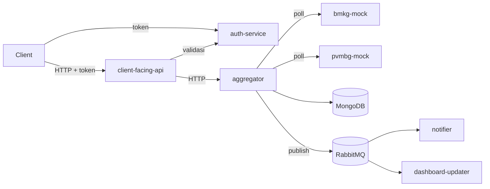

# Platform Agregasi Informasi Kebencanaan

Platform koordinasi kebencanaan yang mengumpulkan data gempa dari BMKG dan data gunung api dari PVMBG (keduanya berupa mock), menyatukannya ke satu format `HazardEvent`, menyimpannya di MongoDB, lalu menyebarkannya lewat RabbitMQ ke consumer dan lewat API ke client. Akses ke API dibatasi token dengan hak akses berbeda untuk tiap jenis client.

Repositori ini berisi kode aplikasi, Dockerfile, pengujian, dan pipeline build. Konfigurasi infrastruktur dan deployment ada di repositori `infra`, dan dokumentasi lengkap ada di repositori `docs`.

## Arsitektur



Aggregator melakukan polling ke BMKG dan PVMBG, memetakan data sumber ke `HazardEvent`, menyimpannya sebagai Canonical Store di MongoDB, dan menerbitkan event ke RabbitMQ. `notifier` dan `dashboard-updater` mengonsumsi event lewat queue masing-masing. Client mengambil data dari `client-facing-api` dengan token dari `auth-service`. Bila PVMBG tidak tersedia, data vulkanik tetap dijawab dari Mongo dan ditandai `stale`.

## Service dan port

Port di bawah berlaku untuk Docker Compose.

| Service | Port di host | Keterangan |
|---|---|---|
| client-facing-api | 8080 | endpoint untuk client, `GET /hazard-events` |
| bmkg-mock | 8081 | header `X-BMKG-Key` |
| pvmbg-mock | 8082 | header `Authorization: Bearer` |
| aggregator | 127.0.0.1:8090 | polling, mapping, Canonical Store, hanya dipakai antar service |
| auth-service | 8091 | penerbit token |
| rabbitmq | 127.0.0.1:5672 dan 15672 | 15672 untuk UI manajemen |
| notifier, dashboard-updater | tidak dibuka ke host | consumer, health di 8093 dan 8092 di dalam jaringan Docker |
| mongo | tidak dibuka ke host | hanya bisa dijangkau aggregator |

Port BMKG, PVMBG, dan client-facing-api bisa diganti lewat `BMKG_PORT`, `PVMBG_PORT`, dan `CLIENT_API_PORT`.

## Menjalankan

Butuh Docker dengan Compose v2. Untuk menjalankan test dibutuhkan Go, dan untuk contoh di bawah dibutuhkan `curl` dan `jq`.

```
cp .env.example .env
openssl rand -base64 32
```

Isi `.env`: tempel hasil `openssl` ke `AUTH_SIGNING_SEED`, lalu ganti setiap `ganti-dengan-nilai-rahasia` dengan nilai Anda sendiri. Setelah itu:

```
docker compose up -d --build
docker compose ps
```

Semua service sehat setelah beberapa detik. Mematikan:

```
docker compose down
```

Tambahkan `-v` untuk ikut menghapus data Mongo dan RabbitMQ.

## Konfigurasi

Semua konfigurasi dibaca dari environment variable. Salin `.env.example` jadi `.env` (tidak ikut ter-commit), lalu ubah nilainya. "Wajib" berarti service menolak start kalau kosong.

| Variabel | Default | Fungsi |
|---|---|---|
| `BMKG_PORT` | 8081 | port bmkg-mock |
| `BMKG_API_KEY` | wajib | kunci header `X-BMKG-Key` |
| `BMKG_DELAY_MS` | 100 | delay tetap BMKG, boleh 50 sampai 150 |
| `BMKG_SEED_COUNT` | 20 | jumlah data awal, minimal 20 |
| `BMKG_GENERATION_INTERVAL_SECONDS` | 10 | jarak kemunculan event baru |
| `BMKG_RANDOM_SEED` | tetap | seed acak, data simulasi bisa diulang |
| `PVMBG_PORT` | 8082 | port pvmbg-mock |
| `PVMBG_TOKEN` | wajib | token Bearer PVMBG |
| `PVMBG_DELAY_MIN_MS`, `PVMBG_DELAY_MAX_MS` | 500, 3000 | rentang delay acak, 500 ≤ min ≤ max ≤ 3000 |
| `PVMBG_SEED_COUNT` | 20 | jumlah data awal, minimal 20 |
| `PVMBG_GENERATION_INTERVAL_SECONDS` | 10 | jarak kemunculan laporan baru |
| `PVMBG_RANDOM_SEED` | tetap | seed acak |
| `AUTH_PORT` | 8091 | port auth-service |
| `AUTH_SIGNING_SEED` | wajib | seed kunci penandatangan token, base64 dari 32 byte |
| `AUTH_INTERNAL_KEY` | wajib | kunci `/revocations`, dipakai auth-service dan client-facing-api |
| `AUTH_ACCESS_TTL_SECONDS` | 60 | umur access token |
| `AUTH_REFRESH_TTL_SECONDS` | 600 | umur refresh token |
| `AUTH_TOKEN_ISSUER` | bnpb-auth | nilai klaim `iss` token |
| `AUTH_CLIENT_MEDIA_ID`, `AUTH_CLIENT_MEDIA_SECRET` | wajib | identitas client Media |
| `AUTH_CLIENT_FIELD_ID`, `AUTH_CLIENT_FIELD_SECRET` | wajib | identitas client Tim Lapangan |
| `AUTH_CLIENT_OPS_ID`, `AUTH_CLIENT_OPS_SECRET` | wajib | identitas client Internal Ops |
| `CLIENT_API_PORT` | 8080 | port client-facing-api |
| `AGGREGATOR_API_KEY` | wajib | kunci `X-Internal-Key` ke aggregator |
| `CLIENT_API_AGGREGATOR_TIMEOUT_MS` | 1500 | timeout panggilan ke aggregator |
| `CLIENT_API_MAX_INFLIGHT` | 200 | batas request bersamaan, selebihnya 429 |
| `CLIENT_API_REVOCATION_POLL_MS` | 250 | jeda sinkron daftar token yang dicabut |
| `AUTH_PUBLIC_KEY` | kosong | opsional, menyematkan kunci publik agar tidak memanggil `/public-key` |
| `AGGREGATOR_PORT` | 8090 | port aggregator |
| `AGGREGATOR_POLL_INTERVAL_SECONDS` | 5 | interval polling ke BMKG dan PVMBG |
| `AGGREGATOR_BMKG_TIMEOUT_MS` | 2000 | timeout ke BMKG |
| `AGGREGATOR_PVMBG_TIMEOUT_MS` | 4000 | timeout ke PVMBG |
| `AGGREGATOR_PVMBG_STALE_AFTER_SECONDS` | 30 | batas data vulkanik ditandai stale |
| `MONGO_ROOT_USERNAME`, `MONGO_ROOT_PASSWORD` | wajib | kredensial MongoDB |
| `MONGO_DB_NAME` | bnpb_canonical | nama database |
| `MONGO_HAZARD_COLLECTION` | hazard_events | nama koleksi |
| `RABBITMQ_USER`, `RABBITMQ_PASSWORD` | wajib | kredensial RabbitMQ |
| `RABBITMQ_EXCHANGE` | hazard_events | nama exchange, sama untuk semua service |
| `RABBITMQ_EXCHANGE_TYPE` | topic | tipe exchange |
| `RABBITMQ_URL` | dirakit compose | string koneksi AMQP, hanya perlu diisi bila service dijalankan di luar Docker |
| `NOTIFIER_QUEUE` | notifier-queue | nama queue notifier |
| `NOTIFIER_BINDING_KEYS` | hazard.# | routing key yang diikat notifier, dipisah koma |
| `NOTIFIER_MIN_SEVERITY` | WASPADA | batas severity untuk alert |
| `NOTIFIER_PROCESS_DELAY_MS` | 0 | simulasi consumer lambat |
| `NOTIFIER_PREFETCH` | 10 | pesan belum di-ack yang boleh dipegang notifier |
| `NOTIFIER_HEALTH_PORT` | 8093 | port health notifier |
| `DASHBOARD_UPDATER_QUEUE` | dashboard-updater-queue | nama queue dashboard-updater |
| `DASHBOARD_UPDATER_PREFETCH` | 10 | pesan belum di-ack yang boleh dipegang dashboard-updater |
| `DASHBOARD_UPDATER_HEALTH_PORT` | 8092 | port health dan `/state` dashboard-updater |
| `BINDING_KEY` | hazard.# | routing key yang diikat dashboard-updater |
| `BMKG_BASE_URL`, `PVMBG_BASE_URL`, `MONGO_URI`, `AGGREGATOR_URL`, `AUTH_SERVICE_URL` | dirakit compose | alamat antar service, hanya perlu diisi bila service dijalankan di luar Docker |

## Contoh penggunaan

Muat `.env` ke shell, lalu ambil token. Token berlaku 60 detik, ulangi perintah ini kalau sudah kedaluwarsa.

```
set -a; source .env; set +a
TOKEN=$(curl -s -X POST localhost:8091/token -d grant_type=client_credentials -d client_id=$AUTH_CLIENT_OPS_ID -d client_secret=$AUTH_CLIENT_OPS_SECRET | jq -r .access_token)
curl -s -H "Authorization: Bearer $TOKEN" "localhost:8080/hazard-events?limit=5" | jq
```

### Perubahan skema tanpa restart

Sumber data boleh menambah field baru. Nyalakan field `confidence_level` di PVMBG, tunggu satu siklus polling, lalu lihat atribut event vulkanik:

```
curl -s -X POST localhost:8082/admin/schema-version -H "Authorization: Bearer $PVMBG_TOKEN" -H "Content-Type: application/json" -d '{"enabled":true}'
curl -s -H "Authorization: Bearer $TOKEN" "localhost:8080/hazard-events?hazard_type=VOLCANIC&limit=5" | jq '.data[] | {hazard_id, attributes}'
```

Event baru punya `confidence_level` di `attributes`, event lama tidak, dan keduanya terbaca. Field yang tidak dikenal selalu diteruskan ke `attributes`. Perubahan yang hanya menambah field didukung, sedangkan hapus, ganti nama, atau ganti tipe field yang sudah dikenal tidak didukung dan event itu dilewati.

### Sumber data mati

Delay PVMBG bisa dinaikkan dengan `PVMBG_DELAY_MIN_MS` dan `PVMBG_DELAY_MAX_MS` (maksimum 3000), lalu `docker compose up -d pvmbg-mock`. Outage juga bisa dinyalakan manual. Selama outage data seismik tetap normal, dan data vulkanik dijawab dari Mongo dengan `meta.sources.pvmbg.stale_since`:

```
curl -s -X POST localhost:8082/admin/outage -H "Authorization: Bearer $PVMBG_TOKEN" -H "Content-Type: application/json" -d '{"enabled":true}'
curl -s -H "Authorization: Bearer $TOKEN" "localhost:8080/hazard-events?hazard_type=VOLCANIC&limit=1" | jq .meta
curl -s -X POST localhost:8082/admin/outage -H "Authorization: Bearer $PVMBG_TOKEN" -H "Content-Type: application/json" -d '{"enabled":false}'
```

### Kredensial dan hak akses

Kredensial silang antar sumber harus ditolak, keduanya menghasilkan 403:

```
curl -i -H "X-BMKG-Key: $PVMBG_TOKEN" localhost:8081/seismic-events
curl -i -H "Authorization: Bearer $BMKG_API_KEY" localhost:8082/volcanic-reports
```

Client Media hanya menerima field ringkasan, dan permintaan eksplisit ke field mentah dijawab 403:

```
MEDIA=$(curl -s -X POST localhost:8091/token -d grant_type=client_credentials -d client_id=$AUTH_CLIENT_MEDIA_ID -d client_secret=$AUTH_CLIENT_MEDIA_SECRET | jq -r .access_token)
curl -s -H "Authorization: Bearer $MEDIA" "localhost:8080/hazard-events?limit=1" | jq
curl -i -H "Authorization: Bearer $MEDIA" "localhost:8080/hazard-events?fields=latitude"
```

Refresh token, memakai client Tim Lapangan:

```
LOGIN=$(curl -s -X POST localhost:8091/token -d grant_type=client_credentials -d client_id=$AUTH_CLIENT_FIELD_ID -d client_secret=$AUTH_CLIENT_FIELD_SECRET)
OLD=$(echo $LOGIN | jq -r .access_token)
RT=$(echo $LOGIN | jq -r .refresh_token)
curl -s -X POST localhost:8091/token -d grant_type=refresh_token -d refresh_token=$RT | jq
```

Tunggu sekitar 2 detik lalu pakai `$OLD` ke `/hazard-events`, hasilnya 401 `token_revoked`. Kalau menunggu lebih dari 60 detik sebelum refresh, hasilnya 401 `token_expired`, dan refresh token tetap berlaku sampai 600 detik. Memakai refresh token yang sama dua kali mencabut seluruh sesi.

### Service independen

Build ulang satu service tanpa menyentuh yang lain, sambil memeriksa bahwa client API tetap menjawab:

```
docker compose up -d --build --no-deps aggregator
curl -s localhost:8080/health
```

Mongo hanya terjangkau dari aggregator, perintah ini harus gagal:

```
docker compose exec client-facing-api wget -T 2 -qO- http://mongo:27017
```

### Pub-sub

Matikan satu consumer, biarkan beberapa event terbit, lalu nyalakan lagi. Event yang terlewat dikirim ulang karena queue-nya durable:

```
docker compose stop notifier
docker compose start notifier
docker compose logs notifier
docker compose exec dashboard-updater wget -qO- localhost:8092/state
```

Menambah consumer baru tanpa mengubah aggregator cukup dengan queue baru:

```
docker compose run -d --no-deps --name consumer3 -e DASHBOARD_UPDATER_QUEUE=consumer3-queue -e DASHBOARD_UPDATER_HEALTH_PORT=8094 dashboard-updater
docker logs consumer3
docker rm -f consumer3
```

Pengiriman bersifat at-least-once, jadi consumer membuang duplikat berdasarkan `hazard_id` dan severity.

### Log

Semua service menulis log JSON ke stdout dengan `correlation_id`. Satu alur dilacak dengan:

```
docker compose logs | grep <correlation_id>
```

Log tidak disimpan permanen. Simpan dulu dengan `docker compose logs --no-color > log.txt` sebelum container dihapus.

## Test

```
for s in services/*/
do
  (cd $s && go test ./...)
done
```

## Build dan deployment

Setiap push ke `main` menjalankan workflow GitHub Actions `.github/workflows/ci.yml` (pull request menjalankan lint, unit test, SAST, dan dependency scanning saja): lint (`go vet`, golangci-lint), unit test dengan `-race` dan coverage, SAST (Semgrep), build image multi-arch (amd64 dan arm64) dengan `ko`, `govulncheck`, scan image dengan Trivy, lalu memicu workflow rilis di repositori `infra` lewat `repository_dispatch`. Image didorong ke Docker Hub dengan dua tag per service: `<service>-<sha8>` dan `<service>-latest`. Deployment ke Kubernetes dikelola dari repositori `infra`. Penjelasannya ada di repositori `docs`.

Konfigurasi di Settings → Secrets and variables → Actions:

| Nama | Jenis | Fungsi |
| --- | --- | --- |
| `DOCKERHUB_USERNAME`, `DOCKERHUB_TOKEN` | Secret | Push image ke Docker Hub dan scan Trivy |
| `INFRA_DISPATCH_TOKEN` | Secret | Fine-grained PAT dengan izin Contents (read/write) pada repositori `infra`, untuk memicu rilis dev |
| `INFRA_REPOSITORY` | Variable | Repositori infra dalam format `owner/repo` |
| `APP_IMAGE_NAME` | Variable | Nama repositori image di Docker Hub. Opsional, default-nya nama repositori ini. Harus sama dengan `APP_IMAGE_NAME` di repositori `infra` |
